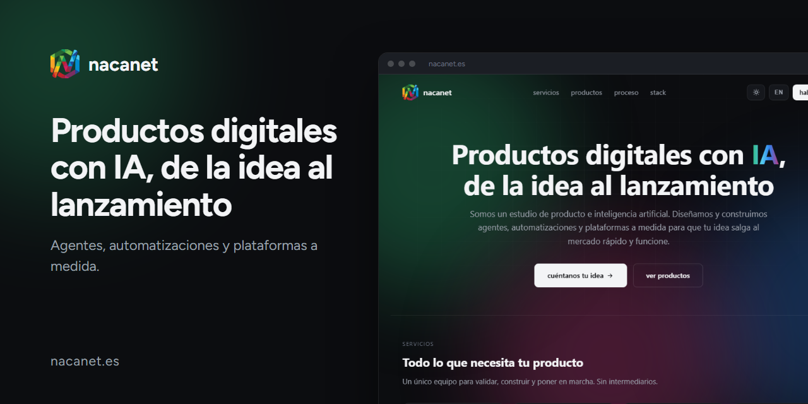

# nacanet

[🇪🇸 Español](README.md) · 🇬🇧 English · [nacanet.es](https://nacanet.es)

**A product and artificial intelligence studio.**
Conversational agents, avatars, automations and custom platforms: from idea to launch.

This repository publishes the [nacanet.es](https://nacanet.es) website with GitHub Pages.

## Products

| Product | What it is | Repo |
|---|---|---|
| **FlowMind** | Chrome extension for ADHD, autism and high ability. | [FlowMind](https://github.com/nacanet/FlowMind) |
| **Inspiratee** | Shop for original t-shirts with mindfulness phrases. | [inspiratee](https://github.com/nacanet/inspiratee) |
| **AI Academy LMS** | WordPress theme for AI academies (React + LearnPress + BuddyPress). | [AI-Academy-LMS-Wordpress-Theme-Freemium](https://github.com/nacanet/AI-Academy-LMS-Wordpress-Theme-Freemium) |

Each product has its own landing page and a README in Spanish and English:

- [nacanet.es/flowmind](https://nacanet.es/flowmind/)
- [nacanet.es/inspiratee](https://nacanet.es/inspiratee/)
- [nacanet.es/ai-academy-lms](https://nacanet.es/ai-academy-lms/)

## Contact

**hola@nacanet.es**
