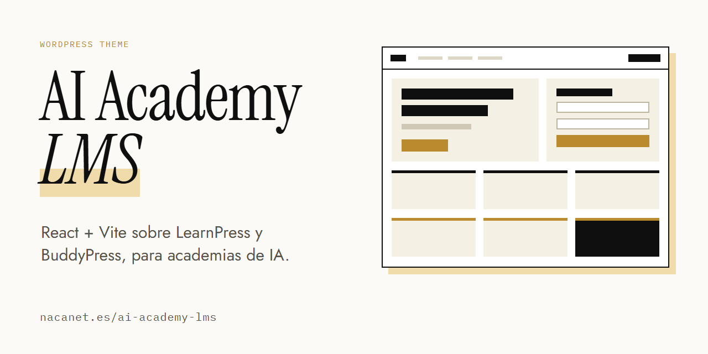

# AI Academy LMS — WordPress Theme

[🇪🇸 Español](README.md) · 🇬🇧 English · [Landing](https://nacanet.es/ai-academy-lms/)

**A WordPress theme with a React (Vite) frontend, ready for LearnPress and BuddyPress.**
Built for developers and agencies setting up artificial intelligence training academies.

## Spec sheet

| | |
|---|---|
| Type | WordPress theme |
| Interface | React 19 · Vite |
| Works with | LearnPress · BuddyPress |
| Requires | WordPress 6.4+ · PHP 8.1+ |
| Build | Node.js 20+ (optional on the server) |
| Interface language | Spanish |
| Typeface | Jost |
| Version | 1.0.0 |

## What is included

- **Hybrid home**: student access and course offer on the same page (hero, login form, integration status, learning tracks, memberships, student area and community). The included tracks and plans are sample copy to be replaced with your own.
- **AI Access**: page template for student sign-in.
- **Sign-up**, **password recovery** and **user dashboard**.
- **LearnPress overrides**: course archive and single course.
- **BuddyPress wrapper** for the community.
- It detects whether LearnPress and BuddyPress are active and adapts the interface.

## Installation

1. Copy the theme folder into `wp-content/themes`.
2. If you need to rebuild, run the theme build on your machine and upload the result.
3. Activate it from the WordPress admin.
4. Install and activate LearnPress and BuddyPress.
5. Create a page with the “AI Access” template for student sign-in.

The theme works without running `npm` on the server: if it ships with its compiled assets, WordPress loads them directly.

## Versions and access

There is a public repository with the description and documentation: [AI-Academy-LMS-Wordpress-Theme-Freemium](https://github.com/nacanet/AI-Academy-LMS-Wordpress-Theme-Freemium). For terms and access to the code, write to **hola@nacanet.es**.

---

A product by [nacanet](https://nacanet.es).
